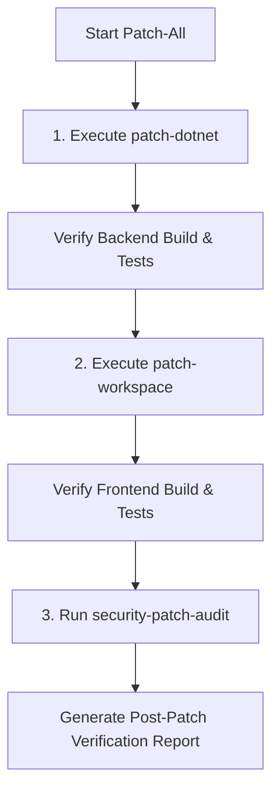

# Patch All Skill

This skill coordinates end-to-end security patching across the entire repository by orchestrating both .NET backend updates and frontend Yarn workspace updates.

---

## 1. Execution Flow



---

## 2. Procedure

### Phase 1: Patch .NET Backend
Follow the procedure in [patch-dotnet](../patch-dotnet/SKILL.md):
1. Identify all vulnerable NuGet packages across all 10 `.csproj` files.
2. Update `<PackageReference>` versions for direct and transitive vulnerable packages.
3. Verify compilation and test suite execution:
   ```bash
   dotnet build backend/pidp-backend.sln
   dotnet test backend/pidp-backend.sln
   ```
4. **Ensure Newest .NET 10 SDK & Runtime**:
   - Verify the base image tags in all 4 backend Dockerfiles (`backend/webapi/Dockerfile`, `backend/services.plr-intake/Dockerfile`, `backend/services.endorsement-reminder/Dockerfile`, `backend/tools.do-work/Dockerfile`) reference `mcr.microsoft.com/dotnet/sdk:10.0-alpine` and `mcr.microsoft.com/dotnet/aspnet:10.0-alpine`.
   - Enforce `--pull` flag during Docker builds (`docker build --pull ...`) so that CI/CD and deployment builds fetch Microsoft's latest monthly security point releases of the .NET 10 runtime/SDK rather than using cached older layers.

### Phase 2: Patch Frontend Workspace
Follow the procedure in [patch-workspace](../patch-workspace/SKILL.md):
1. Update direct dependencies in [`workspace/package.json`](https://github.com/bcgov/moh-pidp/workspace/package.json) (e.g. `@angular/router` and all companion `@angular/*` packages and devtools to `22.2.4`, keeping the entire Angular ecosystem strictly aligned on the same version).
2. Add or update `"resolutions"` for transitive nested vulnerabilities.
3. Install dependencies and update lockfile:
   ```bash
   cd workspace
   yarn install
   ```
4. Verify tests and build:
   ```bash
   cd workspace
   yarn test:ci
   yarn build
   ```

### Phase 3: Post-Patch Verification & Audit
Run the automated security audit script to verify that reported vulnerabilities are eliminated:
```powershell
pwsh -File .agents/skills/security-patch-audit/scripts/run-security-audit.ps1
```

Confirm that:
- `.NET Backend Vulnerabilities` reports no known vulnerable packages across all 10 projects.
- `Priority Action Items (Critical & High)` in the frontend audit has resolved targeted vulnerabilities (such as `@angular/router`).
- The generated report in `reports/` reflects the clean post-patch state.
